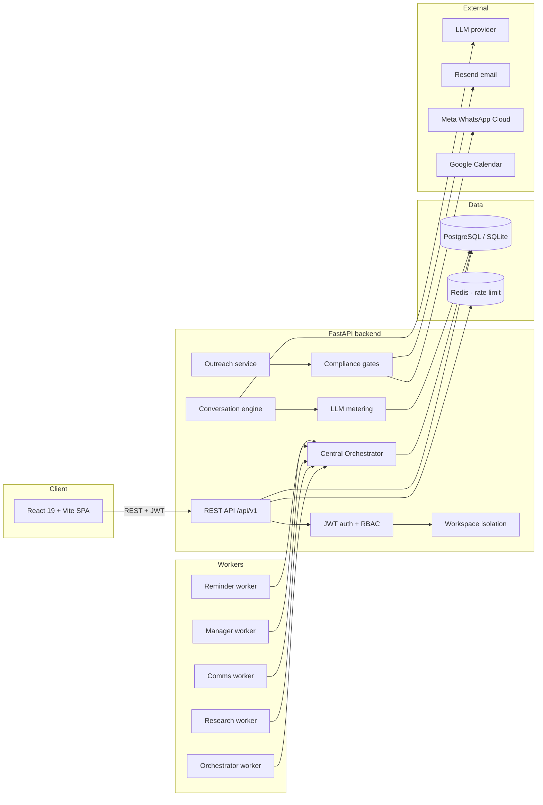

# AG Workforce — Architecture

AG Workforce is an autonomous AI sales department for a B2B café-management
software product. Five AI "employees" (agents) are coordinated by a central
orchestrator that executes persistent, auditable workflows.

## High-level diagram



## Components

### Frontend (`frontend/`)
React 19 + TypeScript + Vite + Tailwind v4 + TanStack Query. Pages:
Overview, AI Employees, Leads/CRM, Pipeline, Conversations, Calendar,
Sales Manager, Workforce Command Centre, Tasks, Lead Research, Campaigns,
Approvals, Notifications, Analytics, Product Knowledge, Operations.
All API calls go through `src/lib/api.ts` (JWT in `localStorage`, 401 →
redirect to /login).

### Backend (`backend/app/`)
- `api/` — FastAPI routers (auth, leads, campaigns, conversations,
  approvals, analytics, workflows, whatsapp, webhooks, system, etc.)
- `services/` — business logic: outreach, conversation_engine,
  compliance, appointments, whatsapp_templates, workers_health,
  prompt_security, llm_metering, workflow_steps
- `tasks/` — five background workers
- `integrations/` — provider adapters (llm, email/resend, whatsapp/meta,
  calendar, research)
- `models/` — SQLAlchemy 2 models (single `__init__.py`)
- `core/` — config (pydantic-settings), database, ratelimit, security

### The five AI employees
1. **Lead Researcher** — discovers/enriches/qualifies leads (`research_worker`)
2. **Sales Executive** — prioritizes, drafts outreach (`outreach.py`)
3. **Communication Manager** — inbound email/WhatsApp, intent, replies
   (`conversation_engine.py`)
4. **Executive Assistant** — demos, appointments, reminders
   (`appointments.py`, `reminder_worker`)
5. **Sales Manager** — funnel analytics, insights (`manager_engine.py`,
   `manager_worker`)

Plus the **Central Orchestrator** running persistent workflows
(`orchestrator_worker` + `workflow_steps.py`).

## Authentication & authorization
- JWT bearer tokens (`/api/v1/auth/login|register`), `AuthContext` carries
  user + workspace.
- RBAC via `require_roles(UserRole.owner|admin|member|viewer)`.
- Every query filters `workspace_id` — tenant isolation is structural,
  not per-endpoint.

## Data flow: outbound message
```
lead → compliance.outbound_block_reason() → approval gate (if required)
     → channel adapter (Resend / Meta Cloud) → Message row
     → provider webhook → status/delivery/bounce → suppression/rollups
```

## LLM flow
```
service → llm_metering.scope(workspace, workflow, step, agent)
        → MeteredLLM wraps provider → LLMInvocation row (tokens, duration,
          status; never prompt text) → budget check on workflows.llm_calls_used
```

## Database & migrations
SQLAlchemy 2 + Alembic. `backend/migrations/versions/` holds the chain.
PostgreSQL gets native UUID/JSONB + an exclusion constraint
(`btree_gist` + `tstzrange`) preventing overlapping confirmed appointments.
SQLite is the default for dev/tests. Never use `create_all` in production
except the documented `AGW_ALLOW_CREATE_ALL=1` escape hatch.

## Workers
Five `WorkerHandle`-instrumented workers write `worker_heartbeats` rows
(stable `type:host:pid` id, last job name only, success/failure counts,
consecutive failures). `GET /system/workers*` exposes health; stale
detection is time-based. No job payloads are persisted in heartbeats.

## Rate limiting
`app/core/ratelimit.py` — in-memory by default; `REDIS_URL` enables
distributed limiting. Production (`ENVIRONMENT=production`) fails closed
(`REQUIRE_REDIS_RATE_LIMIT=1`) rather than silently downgrading.
`GET /system/status` reports backend, reachability, degraded state —
never the URL or credentials.
